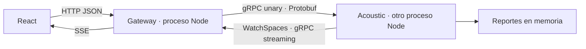

# SilentRadar

Aplicación web colaborativa para encontrar espacios tranquilos de estudio a partir de reportes manuales de estudiantes. Proyecto académico de programación web con **gRPC nativo y Protocol Buffers**.

React muestra cuatro espacios. El usuario reporta una percepción de ruido entre 1 y 5. Un proceso gateway invoca `SubmitReport` por gRPC en otro proceso, Acoustic Service. Este calcula el promedio de los últimos 30 minutos y transmite snapshots con `WatchSpaces`; el gateway los distribuye a los navegadores mediante SSE. Los demás usuarios reciben el cambio sin recargar.

## Ejecutar gratis en tu equipo

Requisito: Node.js 24 LTS y npm. No requiere cuentas cloud, facturación, Docker ni claves.

```sh
npm ci
npm run proto:generate
npm run dev
```

Abre **http://localhost:5173**. Un solo comando inicia Vite, gateway en 3000 y gRPC en 50051 como procesos independientes. Usa Ctrl+C para detenerlos. Las variables de `.env.example` son opcionales; no se carga `.env` automáticamente, se pueden establecer en la terminal o mediante el proveedor de hosting.

Para ejecutar la compilación final, con frontend servido por el gateway:

```sh
npm run build
npm start
```

Abre **http://localhost:3000** en dos pestañas/navegadores.

## Demostrar gRPC

1. Abre la app en dos navegadores. Los cuatro espacios comienzan sin datos.
2. En el primero reporta nivel 2 en Biblioteca central: queda Tranquilo.
3. En el segundo reporta nivel 5 en el mismo espacio: el promedio pasa a 3.5, Ruidoso, en ambos navegadores.
4. La consola muestra `gateway → SubmitReport`, `acoustic → SubmitReport` y `gateway ← WatchSpaces` con la revisión correspondiente.
5. Reinicia el proceso acústico: la UI avisa que está reconectando y reemplaza el estado al recibir el snapshot inicial de la nueva instancia.

El navegador usa HTTP/JSON y SSE; **gRPC real sobre HTTP/2 ocurre entre los backends**. El gateway nunca llama a Acoustic Service mediante HTTP/JSON ni importa su almacén.



## Publicar gratis en Render

El repositorio incluye `render.yaml` con **plan free**. Es suficiente un único Web Service: ejecuta los dos procesos backend y sirve el frontend. gRPC viaja internamente por loopback, sin exponer su puerto a internet. Separación de procesos no implica pagar dos alojamientos.

Desde Render, crea un Blueprint con este repositorio y revisa que figure **Free**. Alternativamente crea un Web Service Node con:

| Ajuste | Valor |
| --- | --- |
| Rama | `main` |
| Build command | `npm ci --include=dev && npm run build` |
| Start command | `npm start` |
| Plan | `Free` |
| Health check | `/health/ready` |
| NODE_VERSION | `24.19.0` |
| TRUST_PROXY_HOPS | `1` |

El gateway utiliza el `PORT` que asigna Render; gRPC conserva el puerto interno 50051 y host 127.0.0.1. La URL pública es la del Web Service, donde funcionan interfaz, API y SSE.

Render Free puede suspender la instancia tras 15 minutos sin tráfico entrante y tarda aproximadamente un minuto en iniciar nuevamente. Reinicios, suspensión y redeploy borran los reportes de esta demo. Hay cuotas de cómputo, transferencia y compilación. Para mantener costo cero, usa el plan Free, evita recursos de pago y no añadas método de pago para que el agotamiento de cuotas suspenda el servicio en lugar de generar sobrecargos. Consulta los [límites oficiales](https://render.com/docs/free). No se implementan pings artificiales para evitar la suspensión.

## Frontend en Vercel, opcional

Si deseas una URL `vercel.app`, importa el mismo repositorio, conserva la raíz del repositorio y utiliza `vercel.json`. Vercel construye solo React. Los backends permanecen en Render.

1. En Vercel establece `VITE_API_URL=https://TU-SERVICIO.onrender.com` antes del build.
2. En Render establece `APP_ORIGIN=https://TU-PROYECTO.vercel.app` con el dominio exacto del frontend; admite varios dominios explícitos separados por coma. No permite comodines de previews.
3. Redeploy del frontend después de cambiar `VITE_API_URL`.

El navegador se conecta directamente al gateway Render mediante CORS limitado a esos orígenes, sin cookies ni proxy SSE de Vercel. No colocar el servidor gRPC en una Function. Vercel Hobby está orientado a [uso personal no comercial](https://vercel.com/docs/plans/hobby).

## Reglas y contratos

- Solo se aceptan niveles enteros 1–5 y espacios del catálogo fijo.
- Reportes con antigüedad estrictamente menor a 30 minutos participan en el promedio.
- Promedio `<2.5`: Tranquilo; `2.5–<3.5`: Moderado; `>=3.5`: Ruidoso.
- Cero reportes: Sin datos, promedio y fecha `null`, nunca tranquilidad inventada.
- Barrido cada 10 segundos y antes de operaciones: el vencimiento se emite aunque nadie reporte.
- Request UUID deduplicado durante 35 minutos dentro del proceso vivo; no se promete persistencia ni entrega exactamente una vez.
- Snapshot completo inicial y tras cambios, revisión `uint64` representada como string y UUID nuevo por arranque.
- SSE/gRPC con reconexión, buffers acotados, límite de conexiones y limpieza al cerrar.
- Máximo 10 intentos de reporte/minuto/IP; protección básica, sin autenticación de usuarios.

El catálogo y los cálculos están en `apps/acoustic/src/domain/store.ts`. El [contrato canónico](packages/contracts/acoustic.proto) define `ListSpaces`, `GetSpace`, `SubmitReport`, `WatchSpaces`. Los tipos generados están versionados en `packages/contracts/generated`; se regeneran desde el `.proto`. Los [esquemas HTTP](docs/contracts/http.schema.json) y validadores Zod se contrastan en pruebas. El [plan](docs/PLAN.md) explica diseño y decisiones.

| HTTP | Acción |
| --- | --- |
| GET `/api/v1/spaces` | Snapshot de cuatro espacios |
| GET `/api/v1/spaces/:id` | Estado individual |
| POST `/api/v1/reports` | Nuevo reporte: 201; duplicado: 200 |
| GET `/api/v1/events` | SSE, eventos nombrados `snapshot` y `connection` |
| GET `/health/live` | Proceso HTTP activo |
| GET `/health/ready` | Llamada unary gRPC real disponible |

```json
{"requestId":"123e4567-e89b-42d3-a456-426614174000","spaceId":"biblioteca-central","level":2}
```

Errores estructurados con código, mensaje, identificador de trazabilidad y detalles. Las validaciones fallidas no crean reportes.

## Comprobar

```sh
npm run check
```

Typecheck estricto, pruebas Vitest y build. Las pruebas incluyen umbrales, expiración exacta con reloj controlado, idempotencia, contrato JSON, serialización Protobuf y gRPC real a través de sockets locales, dos clientes SSE y recuperación tras reiniciar el servicio.

Revisión manual: escritorio 1440, tablet 768, móvil 390/360; reporte mediante teclado, estados vacío/error/reconexión, filtros y orden. Todos los datos iniciales son espacios de ejemplo del caso de estudio, sin reportes fabricados.

## Docker opcional

```sh
docker compose up --build
```

Abre http://localhost:3000. Acoustic y gateway corren en contenedores distintos. Solo se publica el puerto HTTP del gateway. Requiere Docker Desktop activo; Node es suficiente si no dispones de Docker.

## Límites del MVP

Reportes subjetivos, sin micrófono ni decibelios. No hay login ni identidad fiable del reportante. Los datos no se persisten; los reinicios los eliminan. Es una demo académica, no un sistema de medición acústica ni una arquitectura distribuida con consistencia entre réplicas. La publicación requiere sesión propia en Render/Vercel; los archivos de configuración no equivalen a un despliegue completado.
