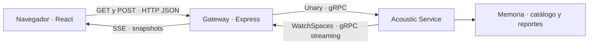

# SilentRadar · Plan técnico y de diseño

Fecha: 13 de octubre de 2026. Alcance: MVP académico con gRPC y publicación gratuita. Actualización acordada: ejecución local con Node.js y publicación completa en Render Free; Vercel es opcional para el frontend. Este documento especifica el trabajo; README y pruebas registran el estado implementado.

## 1. Evaluación y decisiones

La propuesta es viable como demostración académica: navegador → gateway HTTP → servicio gRPC, con SSE hacia el navegador. La separación permite demostrar RPC unary y server streaming entre procesos reales. Para un producto de solo cuatro espacios, dos backends se justifican por el requisito académico; no por una necesidad de escala.

La evaluación inicial se realizó sobre una carpeta vacía. El repositorio creado posteriormente por el usuario es `Jacklb19/SilentQGuard`; SilentRadar es el nombre del producto. El PDF del profesor mencionado en el texto no fue entregado: no se presupone que sus requisitos estén verificados. Prioridades confirmadas por el usuario: app funcional del caso de estudio, gRPC real, herramientas gratuitas y autoría exclusiva del usuario en Git.

| Hallazgo en la propuesta | Resolución obligatoria |
| --- | --- |
| `status` es un string libre | Enum versionado en Protobuf y unión cerrada en JSON. |
| `average_noise = 0` puede significar ausencia | Campo Protobuf opcional; JSON `null` para ausencia. Cero no es un nivel válido. |
| `updated_at` no distingue reporte y recálculo | `lastReportedAt` para el reporte vigente más reciente; `serverTime` para la foto del estado. |
| La descripción 1–2/3/4–5 no define promedios decimales | Umbrales explícitos 2.5 y 3.5, sin redondear antes de clasificar. |
| Streaming sin estado inicial ni recuperación | Snapshot completo inicial y tras cada cambio, con identidad de proceso y revisión. |
| No se precisa qué ocurre al vencer un reporte | Depuración antes de cada lectura/escritura y cada 10 segundos. |
| `success` y `message` mezclan resultados con errores | Respuesta de éxito tipada; errores gRPC convertidos a códigos HTTP. |
| Reintentar POST puede registrar dos reportes | `requestId` obligatorio e idempotencia temporal dentro del proceso. |
| Una instancia en nube se presenta como suficiente | Demo con memoria temporal; los reinicios y la suspensión del hosting gratuito borran reportes. |
| Cuatro horas incluyen demasiada incertidumbre de infraestructura | Preparación previa y primer despliegue pequeño al inicio; puertas de avance y contingencia. |

**Decisión:** conservar React, gateway, gRPC y SSE; usar TypeScript en todo el proyecto; servir el frontend desde el gateway; mantener memoria exclusivamente para el MVP académico. El plan de cuatro horas es un objetivo condicionado a herramientas y acceso cloud preparados, no una garantía.

## 2. Producto y alcance

**Problema:** localizar rápidamente un espacio adecuado para concentrarse a partir de percepciones recientes de otros estudiantes.

**Flujo:** abrir lista → comparar estados y antigüedad → elegir espacio → reportar percepción de ruido → confirmar → observar actualización en otro navegador.

Incluido: cuatro espacios fijos, estado acústico, promedio, cantidad de reportes vigentes, antigüedad, reporte manual 1–5, búsqueda por nombre/ubicación, filtro por estado, orden por tranquilidad y conexión en vivo. La búsqueda y el orden se resuelven en el cliente para cuatro registros.

Fuera del MVP: usuarios, login, micrófono, decibelios, GPS, mapa interactivo, reservas, ocupación, históricos, administración, IA y notificaciones push. Ningún texto o gráfico debe presentar la escala como medición física ni la cantidad de reportes como número de personas.

Datos iniciales de demostración, reemplazables por lugares reales sin cambiar contratos:

| ID estable | Nombre | Ubicación |
| --- | --- | --- |
| `biblioteca-central` | Biblioteca central | Piso 2 · Zona de lectura |
| `sala-estudio-a` | Sala de estudio A | Bloque B · Segundo piso |
| `cafeteria` | Cafetería | Zona común |
| `laboratorio-3` | Laboratorio 3 | Bloque de ingeniería |

Todos arrancan **sin reportes**. Los datos ilustrativos de una maqueta nunca se insertan como reportes reales de producción.

## 3. Stack elegido

| Capa | Elección | Motivo |
| --- | --- | --- |
| Runtime | Node.js 24 LTS, misma versión en desarrollo y Docker | Ya disponible localmente; una sola plataforma para ambos backends. |
| Lenguaje | TypeScript con `strict` | Contratos y lógica consistentes en las tres aplicaciones. |
| Frontend | React + Vite | Aplicación de una pantalla, sin necesidad de SSR. |
| Estilos | Tailwind CSS 4 con plugin Vite y tokens CSS | Control visual directo y CSS mantenible. |
| Interacciones | Radix Dialog y Lucide React | Modal accesible e iconos discretos. |
| Gateway | Express 5 | Rutas HTTP y SSE pequeñas y explícitas. |
| RPC | `@grpc/grpc-js` + `@grpc/proto-loader` | gRPC nativo en Node, con carga del contrato compartido. |
| Tipos RPC | `proto-loader-gen-types` | Generar tipos desde el `.proto`; no copiar interfaces RPC a mano. |
| Validación HTTP | Zod | Validar entradas y controlar el mapeo de DTOs. |
| Tiempo real | EventSource nativo / SSE | Canal servidor → cliente sin infraestructura adicional. |
| Estado UI | Hook propio + reducer React | Cuatro espacios; sin Redux ni cache de consultas adicional. |
| Workspace | npm workspaces, `tsx` en desarrollo, `tsc` para backends | Node/npm disponible; scripts sencillos. |
| Pruebas | Vitest; Supertest para gateway | Reloj controlado y pruebas de integración reales. |
| Entrega | Node.js, Docker opcional + Compose; Render Free | Ejecución gratuita y dos procesos reales, con una sola URL. |
| Aislamiento RPC | Loopback en Render; red privada de Compose | El servicio gRPC no se publica en internet. |

Fijar versiones exactas en el lockfile al crear el proyecto y ejecutar `npm ci` en CI/Docker. No tomar `latest` como configuración reproducible. Node 24 figura en la línea LTS del [calendario oficial](https://github.com/nodejs/Release). Vite y Tailwind se integrarán siguiendo sus [guías de instalación](https://vite.dev/guide/) y [plugin oficial](https://tailwindcss.com/docs/installation/using-vite).

No se necesitan Next.js, ORM, Redis, Kubernetes, Envoy ni gRPC-Web para este alcance.

## 4. Arquitectura y límites



Hay **dos procesos backend independientes**: `gateway`, incluye archivos del frontend compilado; `acoustic-service`, habla gRPC. En Render Free comparten un alojamiento y se comunican por `127.0.0.1:50051`; únicamente HTTP del gateway está expuesto y escucha `0.0.0.0:$PORT`. En Compose se ejecutan en dos contenedores. En desarrollo: Vite 5173, gateway 3000, acoustic 50051. Vite redirige `/api` al gateway; el navegador usa rutas relativas.

**Frontend:** presentar datos, filtrar, ordenar, validar la interacción y controlar el estado de conexión. Nunca calcula el promedio oficial ni determina vencimientos.

**Gateway:** validar JSON, llamar RPC con deadline, transformar Protobuf a JSON, distribuir SSE, servir estáticos, aplicar límites HTTP y registrar errores. No almacena reportes ni decide estados acústicos. Su cache de snapshot es únicamente transporte, invalidada al perder el stream.

**Acoustic Service:** validar otra vez, consultar catálogo, asignar UUID/fecha, deduplicar, guardar reportes, calcular agregados, incrementar revisión y emitir snapshots. Es el dueño del dominio.

Separación interna: `domain` contiene reglas puras; `application` casos de uso y reloj inyectable; `infrastructure` repositorio en memoria y adaptador gRPC. Interfaces pequeñas, sin framework de inyección ni capas vacías. Una operación de validación/depuración/mutación/snapshot se ejecuta sin `await` intermedio para no intercalar escrituras dentro del proceso Node.

## 5. Modelo de datos y reglas

### Entidades

| Entidad | Campos | Restricciones |
| --- | --- | --- |
| SpaceDefinition | `id`, `name`, `location` | ID único e inmutable; catálogo fijo. |
| NoiseReport | `id`, `requestId`, `spaceId`, `level`, `receivedAt` | UUIDs; espacio existente; entero 1–5; hora del servidor UTC. |
| SpaceState | definición + `averageNoise`, `status`, `recentReportCount`, `lastReportedAt` | Agregado derivado, no editable. |
| SpaceSnapshot | `serviceInstanceId`, `revision`, `serverTime`, `spaces` | Identidad nueva por arranque; revisión monotónica dentro del proceso. |
| IdempotencyEntry | `requestId`, payload original, reporte original, `expiresAt` | Retención de 35 minutos; máximo 5.000 entradas. |

Repositorio MVP: `Map<spaceId, SpaceDefinition>`, `Map<spaceId, NoiseReport[]>`, mapa de deduplicación y registro de suscriptores. Sin tablas ni base de datos en este alcance. Mantener hasta 1.000 reportes vigentes por espacio; al llegar al límite rechazar nuevos con `RESOURCE_EXHAUSTED`, nunca borrar reportes válidos silenciosamente.

### Cálculo normativo

Usar un único `now` por operación. Un reporte participa cuando:

```text
now - 30 minutos < receivedAt <= now
averageNoise = suma(level) / recentReportCount
0 reportes        → NO_DATA, averageNoise=null, lastReportedAt=null
promedio < 2.5    → QUIET
2.5 <= prom < 3.5 → MODERATE
promedio >= 3.5   → LOUD
```

Al cumplir exactamente 30 minutos el reporte vence. Clasificar con precisión completa; mostrar promedio con un decimal, aclarando que es aproximado. `recentReportCount` cuenta reportes, no usuarios. `lastReportedAt` es la fecha máxima de los reportes **vigentes**.

Depurar antes de `ListSpaces`, `GetSpace`, `SubmitReport`, primer snapshot de `WatchSpaces` y cada 10 segundos. Si cambia un agregado por expiración, aumentar revisión y emitir snapshot con motivo `REPORTS_EXPIRED`. El retraso visible del vencimiento debe ser de hasta 10 segundos más transporte en una instancia activa. No aumentar revisión solo porque cambió `serverTime`.

Un reporte nuevo aceptado aumenta revisión y produce un snapshot `REPORT_ACCEPTED`, aunque la etiqueta acústica permanezca igual. La revisión inicial es `0`. Se compara como `BigInt`, no como `Number` JavaScript.

### Idempotencia y abuso

El navegador genera `requestId` UUID por envío lógico. Si la respuesta se pierde, un reintento conserva ese UUID. El servicio reconoce mismo ID + mismo payload y devuelve el reporte original, `duplicate=true` y snapshot **actual**, sin registrar ni emitir un reporte nuevo. Mismo ID con otro payload → `ALREADY_EXISTS` / HTTP 409.

La garantía solo dura 35 minutos y solo dentro del proceso vivo. Tras reinicio, pérdida de memoria o ese plazo no hay garantía de deduplicación. No prometer entrega exactamente una vez. No hacer reintentos automáticos ilimitados de POST. Depurar entradas vencidas antes de insertar; si el mapa alcanza 5.000 entradas todavía vigentes, rechazar nuevos IDs con `RESOURCE_EXHAUSTED` y conservar los anteriores. Los duplicados conocidos pueden seguir devolviendo su respuesta.

Gateway: máximo 10 intentos de reporte/minuto/IP, 5 conexiones SSE/IP y 100 SSE por proceso, body de 2 KiB. Validar encabezados de origen en POST si existen; no habilitar CORS abierto. Configurar proxies de confianza según entorno; no confiar en `X-Forwarded-For` arbitrario. El límite es una protección básica de demo, no identidad ni garantía contra manipulación. No recolectar IP en reportes ni guardar trazas con cuerpos completos.

## 6. Contrato gRPC

La especificación completa está en [../packages/contracts/acoustic.proto](../packages/contracts/acoustic.proto), paquete `silentradar.acoustic.v1`.

| RPC | Entrada | Salida | Semántica |
| --- | --- | --- | --- |
| ListSpaces | Empty | SpaceSnapshot | Los cuatro espacios, en orden de catálogo. |
| GetSpace | spaceId | GetSpaceResponse | Estado individual y metadatos de versión. |
| SubmitReport | requestId, spaceId, level | Report, snapshot, duplicate | Timestamp y UUID del reporte asignados por servicio. |
| WatchSpaces | Empty | stream SnapshotEvent | Snapshot inicial completo y posteriores cambios completos. |

Enums tienen valor cero `UNSPECIFIED`, distinto de `NO_DATA`. El servidor nunca devuelve `UNSPECIFIED` como estado válido. Protobuf no valida rango 1–5 ni existencia de un espacio: se valida en el caso de uso. La [presencia explícita de campos](https://protobuf.dev/programming-guides/proto3/) permite distinguir promedio ausente de cero.

`Timestamp` se transforma a ISO 8601 UTC; `uint64 revision` se transforma a string decimal. Configurar proto-loader con `keepCase: false`, `longs: String`, `enums: String`, `defaults: false`, `oneofs: true`. El mapper interpreta presencia de `averageNoise`; no confía en valores por defecto ni expone directamente objetos del loader.

Generar tipos con las mismas opciones que el loader y compilar ambos servicios en CI. El mapper convierte explícitamente `ACOUSTIC_STATUS_QUIET` a `QUIET` y los demás estados, y `SNAPSHOT_REASON_INITIAL` a `INITIAL` y los demás motivos. Un valor desconocido o `UNSPECIFIED` en una respuesta es error de contrato, nunca se transforma silenciosamente en sin datos. No reutilizar números de campos eliminados; reservarlos con `reserved`. Cambios incompatibles requieren paquete v2. HTTP tiene mapper propio y no se denomina ProtoJSON.

## 7. HTTP, JSON y errores

Los esquemas formales están en [contracts/http.schema.json](contracts/http.schema.json). Se referencian por `$defs`; incluyen request, Space, snapshot, reporte, respuestas y errores. Las invariantes entre campos y el catálogo se validan adicionalmente en dominio.

| Ruta | Éxito | Cuerpo |
| --- | --- | --- |
| GET `/api/v1/spaces` | 200 | SpaceSnapshot JSON |
| GET `/api/v1/spaces/:id` | 200 | GetSpaceResponse JSON |
| POST `/api/v1/reports` | 201 nuevo / 200 duplicado | SubmitReportResponse JSON |
| GET `/api/v1/events` | 200 stream | Eventos SSE definidos abajo |
| GET `/health/live` | 200 | `{ "status": "ok" }`, solo proceso gateway |
| GET `/health/ready` | 200 / 503 | `{ "status": "ready" }` o error; prueba unary con deadline de 2 s |

Request exacto:

```json
{"requestId":"123e4567-e89b-42d3-a456-426614174000","spaceId":"biblioteca-central","level":2}
```

No aceptar `level` string, float, null, fechas del cliente ni campos adicionales. Validar `spaceId` como slug de 1–64 caracteres y después su existencia. Rechazar JSON mal formado con 400, content-type incompatible con 415 y body grande con 413. Respuestas de dominio llevan `Cache-Control: no-store`.

Ejemplo de estado:

```json
{
  "serviceInstanceId":"123e4567-e89b-42d3-a456-426614174001",
  "revision":"7",
  "serverTime":"2026-10-14T01:00:00.000Z",
  "spaces":[{
    "id":"biblioteca-central","name":"Biblioteca central",
    "location":"Piso 2 · Zona de lectura","averageNoise":2,
    "status":"QUIET","recentReportCount":3,
    "lastReportedAt":"2026-10-14T00:58:00.000Z"
  }]
}
```

El ejemplo recorta la lista; la respuesta real incluye los cuatro espacios. JSON sin datos usa `NO_DATA`, `averageNoise: null`, `recentReportCount: 0`, `lastReportedAt: null`. Los timestamps de este ejemplo corresponden a la noche del 13 de octubre en Bogotá; transporte siempre UTC, UI en zona local del navegador.

| gRPC / fallo | HTTP | Código JSON |
| --- | --- | --- |
| INVALID_ARGUMENT | 400 | INVALID_ARGUMENT |
| NOT_FOUND | 404 | SPACE_NOT_FOUND |
| ALREADY_EXISTS | 409 | IDEMPOTENCY_CONFLICT |
| RESOURCE_EXHAUSTED | 429 | RATE_LIMITED |
| UNAVAILABLE | 503 | SERVICE_UNAVAILABLE |
| DEADLINE_EXCEEDED | 504 | UPSTREAM_TIMEOUT |
| UNAUTHENTICATED / PERMISSION_DENIED entre servicios | 502 | UPSTREAM_AUTH_ERROR |
| INTERNAL o desconocido | 500 | INTERNAL_ERROR |

El 502 de autenticación upstream queda reservado para una evolución que requiera autenticación entre hosts; en la versión gratuita el canal es privado por loopback/red Docker. Los [status gRPC](https://grpc.io/docs/guides/status-codes/) conservan su semántica dentro del backend. Deadline unary: 5 segundos; readiness: 2 segundos.

Formato uniforme, también para validación HTTP:

```json
{"error":{"code":"INVALID_ARGUMENT","message":"Selecciona un nivel entre 1 y 5.","requestId":"123e4567-e89b-42d3-a456-426614174002","details":[{"field":"level","issue":"Debe ser un entero entre 1 y 5."}]}}
```

`error.requestId` identifica la petición HTTP para correlación; no es necesariamente el UUID de idempotencia. No exponer stack traces ni detalles de credenciales. Responder `Retry-After` cuando un límite temporal lo permita.

## 8. Streaming y recuperación

Un stream `WatchSpaces` por proceso gateway, compartido entre navegadores. El servicio registra el suscriptor y genera su snapshot inicial en una sección síncrona, sin escrituras intercaladas. Cada evento incluye estado completo; con cuatro espacios, esta sencillez compensa el pequeño tamaño adicional.

SSE envía eventos nombrados `snapshot` y `connection`; no usar solo `onmessage`. `connection` lleva `{status:"syncing"|"live"|"reconnecting"}`. Solo enviar `live` cuando existe un snapshot inicial válido del stream gRPC actual.

```text
retry: 3000

event: snapshot
id: <serviceInstanceId>:<revision>
data: {"reason":"INITIAL","snapshot":{...}}

```

Encabezados: `Content-Type: text/event-stream`, `Cache-Control: no-cache, no-transform`, `X-Accel-Buffering: no`; flush inmediato. Excluir stream de compresión y buffering. Heartbeat SSE como comentario cada 15 s; no modifica revisión ni sustituye estado `live`.

Nuevo navegador: si cache está sincronizada, recibir snapshot actual como `INITIAL`; si no, esperar la reconexión del upstream con estado `syncing`. Al caer gRPC, invalidar cache para conexiones nuevas y avisar `reconnecting` a clientes existentes. Conservar datos anteriores en pantalla con aviso de desconexión.

Reconectar gRPC con backoff 1, 2, 4, 8, hasta 30 s y jitter; reiniciar backoff después del snapshot inicial. Reintentar fallos transitorios y el fin normal por rotación. El canal gratuito por loopback no requiere IAM. Cancelar el stream antiguo antes de reemplazarlo y retirar listeners/timers al cerrar.

EventSource reconecta SSE; cada reconexión obtiene un snapshot nuevo. `Last-Event-ID` no solicita replay: se documenta que siempre se resincroniza con estado actual. No se garantiza recibir cada transición intermedia. Limpiar timers y buffers al cerrar clientes; una caída de gRPC no debe detener las reconexiones porque existan cero navegadores conectados.

Reglas cliente: primer snapshot de una conexión activa establece identidad y revisión; siguientes snapshots del mismo proceso solo se aplican si tienen revisión mayor. Snapshot inicial de nueva conexión puede cambiar identidad y reemplaza todos los espacios. Usar un identificador local de conexión para ignorar callbacks de conexiones cerradas. Si una misma conexión recibe cambio de identidad mediante un nuevo snapshot inicial del gateway, también reemplazar estado.

GET sirve como carga inicial/fallback: una respuesta GET tardía no reemplaza datos si SSE ya sincronizó. POST incluye snapshot para actualizar inmediatamente si coincide identidad y revisión es mayor; si trae otra identidad, solicitar resincronización SSE antes de asumir consistencia. Si el reporte fue aceptado pero falta sincronización, mostrar confirmación de envío y estado de conexión por separado.

Backpressure: si `write()` indica buffer lleno, mantener solo el último snapshot pendiente por cliente, no una cola ilimitada; tras 30 s sin `drain`, cerrar ese cliente. Aplicar la misma política al stream gRPC. El contrato representa estado actual y permite omitir estados intermedios. Limitar también a 10 watchers gRPC por proceso acústico para la demo.

## 9. UI: dirección visual definida

**Concepto: directorio de lugares de estudio con lenguaje de señalética universitaria y cuidado editorial.** Una interfaz tranquila, práctica, con identidad propia. La pantalla principal empieza por espacios disponibles, no por contenido promocional.

### Tokens

| Token | Valor | Uso |
| --- | --- | --- |
| Fondo | `#F4F1E9` | Lienzo cálido |
| Superficie | `#FFFEFA` | Lista y modal |
| Texto principal | `#202D27` | Títulos y cuerpo |
| Texto secundario | `#526158` | Ubicación y antigüedad |
| Borde | `#D7DDD3` | Separadores |
| Marca / CTA | `#234D3C` | Acciones y encabezado |
| Tranquilo | texto `#24583E`, fondo `#E5F0E4` | Etiqueta + icono |
| Moderado | texto `#755019`, fondo `#F5ECD8` | Etiqueta + icono |
| Ruidoso | texto `#963B2E`, fondo `#F9E6DF` | Etiqueta + icono |
| Sin datos | texto `#526158`, fondo `#EAEDE7` | Etiqueta + icono |

Tipografía: **Newsreader** semibold para el título principal y un uso puntual editorial; **Public Sans** para cuerpo y controles, archivos WOFF2 locales con `font-display: swap`. Tamaños: H1 40/44 px escritorio, 30/34 móvil; nombre de espacio 18/24; cuerpo 15/22; etiquetas 13/18. Evitar cursivas largas. Verificar contraste en navegador: texto normal al menos 4.5:1; estados y foco no dependen solo del color.

Escala de espacio 4/8/12/16/24/32/48; esquinas 8 px, modal 12 px. Sombras solo en modal y superficies flotantes. Iconos Lucide de 18–20 px. Marca tipográfica con pequeño indicador de radar construido en SVG sencillo; sin fotografía necesaria para este directorio.

### Pantalla principal

Contenedor de 1120 px máximo, márgenes 40 px en escritorio y 20 px en móvil. Header de 72 px: marca a la izquierda, «Campus · espacios de estudio» y conexión a la derecha. Sin sidebar.

Bloque inicial: título «Un lugar para concentrarte.»; texto «Consulta el ruido reportado en los últimos 30 minutos.»; contador pequeño «4 espacios · 2 tranquilos», calculado a partir de datos vigentes. No mostrar contador de tranquilos antes de cargar.

Barra de controles: búsqueda «Buscar espacio o ubicación», filtro «Todos / Tranquilos / Moderados / Ruidosos / Sin datos», selector «Más tranquilos / Nombre / Reporte más reciente». Orden inicial: promedio ascendente, sin datos al final, empate por nombre. Evitar que filas se muevan mientras un usuario interactúa con ellas: modal conserva el ID seleccionado; aplicar reordenamiento tras cerrar o fuera del foco de la fila.

Lista con una superficie compartida y separadores finos. Cada fila de 104–120 px en escritorio tiene: nombre/ubicación, etiqueta de estado, indicador discreto 1–5, «3 reportes · hace 2 min», botón «Reportar». Indicador solo representa promedio y tiene etiqueta textual; no aparenta lectura de decibelios. El color complementa el texto. «Sin datos recientes» sustituye promedio e indicador con «—».

```text
SilentRadar                              Campus · En vivo

Un lugar para concentrarte.              4 espacios · 2 tranquilos
Consulta el ruido reportado en los últimos 30 minutos.

[Buscar espacio o ubicación…] [Todos ▾] [Más tranquilos ▾]
───────────────────────────────────────────────────────────────
Biblioteca central     Tranquilo    2.0/5    3 reportes  [Reportar]
Piso 2 · Zona de lectura                     Hace 2 min
───────────────────────────────────────────────────────────────
Sala de estudio A      Moderado     3.0/5    2 reportes  [Reportar]
Bloque B · Segundo piso                      Hace 6 min
───────────────────────────────────────────────────────────────
```

Wireframe con datos ficticios para explicar la jerarquía. No es una vista implementada.

Footer pequeño: «Percepciones de estudiantes. Pueden variar durante el día.» y «Ventana de 30 minutos». No insertar explicaciones sobre gRPC en el flujo del usuario.

### Modal de reporte

Título «¿Cómo está la Biblioteca central?»; subtítulo «Reporta el ruido que percibes ahora.» Cinco opciones de radio con número y descripción: 1 «Muy tranquilo», 2 «Tranquilo», 3 «Moderado», 4 «Ruidoso», 5 «Muy ruidoso». No preseleccionar un valor ni solicitar acceso al micrófono.

Ancho 480 px, opciones en filas con target mínimo 44 px. Acción primaria «Enviar reporte», deshabilitada hasta seleccionar; secundaria «Cancelar». Durante envío: «Enviando…», evitar doble submit; éxito: cerrar y toast «Reporte enviado. Gracias por avisar.» Error recuperable inline conserva la selección y el requestId. Para timeout: «No pudimos confirmar el envío. Reintenta para comprobarlo.» Reintento usa mismo UUID. Si se cancela/cierra durante una petición, puede haberse aceptado; el stream sigue siendo la fuente de actualización.

Focus trap, foco inicial en título o grupo, Escape y retorno al botón disparador; navegación por radio con flechas. No permitir un segundo envío concurrente. No cerrar automáticamente un error.

### Responsive y estados

Desde 768 px, fila en columnas; debajo, nombre y etiqueta arriba, ubicación/metadatos debajo, botón de ancho disponible. Controles en columna en móvil, filtro mediante select accesible. Modal centrado con margen 16 px y scroll interno. Nada debe desbordar a 360 px.

| Estado | Presentación y conducta |
| --- | --- |
| Carga inicial | Cuatro skeletons de altura estable, sin inventar estados. |
| Todo sin datos | Cuatro filas visibles y texto «Todavía no hay reportes recientes. Puedes enviar el primero.» |
| Filtro sin resultados | «No hay espacios con este filtro.» y «Limpiar filtros». |
| API no disponible | «No pudimos cargar los espacios.» con botón «Reintentar». |
| SSE conectando | «Conectando», sin punto verde de vivo. |
| Stream caído | «Reconectando» y «La actualización en vivo está interrumpida.»; datos previos visibles. |
| Reporte limitado | Error con plazo aproximado de reintento si está disponible. |
| Datos vencidos | Etiqueta y conteo cambian automáticamente a sin datos. |

Animaciones de 120–180 ms para controles y actualización suave de etiqueta; respetar `prefers-reduced-motion`. No parpadeos ni pulso constante. `aria-live=polite` para confirmación y conexión; evitar leer toda la lista tras cada evento. Actualizar texto relativo cada minuto con reloj del navegador y limitar antigüedad mínima a cero; es una referencia aproximada que depende de su reloj. La caducidad real siempre la decide el servicio. No usar la fecha de un snapshot cacheado como si fuera la hora actual del servidor. Información exacta de fecha disponible en tooltip accesible o texto de detalle.

La calidad visual se juzga por jerarquía, espaciado, legibilidad y comportamiento real. Evitar gradientes morados, tarjetas gigantes, orbes, métricas inventadas y decoración que distrae de comparar lugares.

## 10. Despliegue y configuración

Decisión aprobada: **toda la app en Render Free**, con opción de frontend separado en Vercel Hobby. Ambos backends son procesos distintos, supervisados por `scripts/run.mjs`; gRPC circula en loopback y solo el gateway está expuesto por HTTPS. No se requiere Google Cloud, facturación ni tarjetas para desarrollar.

`render.yaml` define Web Service Node gratuito, build `npm ci --include=dev && npm run build`, inicio `npm start`, readiness `/health/ready` y Node 24. Gateway escucha `0.0.0.0:$PORT`; Acoustic escucha `127.0.0.1:50051`. No usar `PORT` del hosting para ambos procesos. Render admite [servicios Node con puerto HTTP público](https://render.com/docs/web-services).

Variables: gateway `PORT`/`GATEWAY_PORT`, `GRPC_TARGET`, `APP_ORIGIN`, `TRUST_PROXY_HOPS`; acústico `ACOUSTIC_PORT`, `ACOUSTIC_HOST`, `REPORT_WINDOW_SECONDS=1800`, `SWEEP_INTERVAL_SECONDS=10`. En Render se configura un salto de proxy; en local ninguno. No confiar en headers de proxy fuera del entorno configurado. Por defecto gRPC solo escucha loopback; Compose habilita `0.0.0.0` exclusivamente dentro de su red privada.

Vercel opcional: build de React con `vercel.json`; `VITE_API_URL` apunta a Render; gateway acepta únicamente el origen exacto configurado en `APP_ORIGIN`. SSE conecta directamente a Render, sin Function intermediaria. [Vercel Hobby](https://vercel.com/docs/plans/hobby) se usa para el proyecto académico personal, no comercial.

Los [límites de Render Free](https://render.com/docs/free) incluyen suspensión por inactividad, cuotas y posibles reinicios. Un arranque frío puede tardar alrededor de un minuto. Para mantener costo cero, elegir Free y no añadir un método de pago: si las cuotas se agotan, el proveedor puede suspender servicios o builds. No usar pings artificiales para forzar disponibilidad permanente. La memoria se pierde al suspender, reiniciar o desplegar. Las lecturas siempre depuran reportes, aunque el timer se haya detenido.

Docker es opcional: dos imágenes multi-stage, usuario no root, red privada para gRPC, único puerto público HTTP, health TCP acoustic y HTTP gateway. En Node sin Docker, basta `npm run dev` o `npm run build` seguido de `npm start`. Streams rotan a los 50 minutos, se reconectan y resincronizan.

Logs JSON con identificador HTTP, método RPC, revisión y errores; readiness ejecuta una llamada unary real. Nunca registrar credenciales. La publicación exige una sesión del usuario en Render; los archivos de configuración no prueban que esté desplegado.

**Evolución posterior:** PostgreSQL con FK de reportes a espacios, `CHECK(level BETWEEN 1 AND 5)`, índice `(space_id, received_at)`, `request_id UNIQUE`, timestamps UTC y outbox para eventos compartidos. No guardar SQLite en el disco efímero de un hosting esperando persistencia. Esta fase queda fuera del MVP gratuito acordado.

## 11. Organización del proyecto a crear

```text
SilentQGuard/
  apps/
    web/src/{components,hooks,lib,styles}/
    gateway/src/{http,grpc,sse,mappers}/
    acoustic/src/{domain,application,infrastructure}/
  packages/
    contracts/{acoustic.proto,generated/}
    http-contracts/{schemas.ts,mappers.test.ts}
  tests/integration/
  docs/{PLAN.md,contracts/}
  deploy/{gateway.Dockerfile,acoustic.Dockerfile}
  compose.yaml
  package.json
  package-lock.json
  README.md
  .env.example
```

El proto canónico se trasladó a `packages/contracts`; no hay una segunda copia editable. JSON Schema sigue en `docs/contracts`; los validadores Zod y las pruebas contrastan ejemplos válidos e invariantes inválidas. Las restricciones relacionales del catálogo y el máximo uint64 se comprueban adicionalmente en código.

Componentes UI: `AppHeader`, `ConnectionIndicator`, `SpaceToolbar`, `SpaceList`, `SpaceRow`, `NoiseIndicator`, `StatusBadge`, `ReportDialog`, `FeedbackToast`, `EmptyState`. Hooks: `useSpacesStream`, `useReportSubmission`, `useRelativeTime`. Reducer único para snapshots y conexión; filtro y modal son estado de UI independiente.

## 12. Ejecución objetivo: 240 minutos

Preparación previa: Node/npm y cuentas gratuitas en Render/Vercel si se publica; Docker es opcional. No se requiere facturación, gcloud ni registry. Los bloqueos de login se resuelven con la sesión del usuario, sin compartir contraseñas en el chat.

| Minutos | Trabajo | Puerta de salida |
| --- | --- | --- |
| 0–25 | Workspace, strict TS, tipos proto, shells de dos procesos y configuración de Render Free | Gateway invoca gRPC local; requisitos de publicación comprobados temprano. |
| 25–75 | Catálogo, reloj, repositorio, reglas, deduplicación, cuatro RPC, snapshots y barrido | Pruebas de umbrales/expiración pasan; stream inicial real. |
| 75–115 | Rutas HTTP, mappers, errores, SSE compartido, reconexión y cleanup | Dos clientes reciben mismo estado tras reportar y reconectar. |
| 115–170 | UI con tokens, lista, controles, modal, estados y responsive | Flujo usable por teclado y a 390 px; no hay errores de consola. |
| 170–205 | Build final, Render Free y frontend estático servido por gateway | URL pública, procesos separados, stream funcionando. |
| 205–240 | Pruebas de aceptación, revisión visual y README/sustentación | Evidencias y demo de cinco minutos lista. |

Si nube falla al principio, continuar lógica/UI en Compose y registrar el bloqueo concreto; despliegue sigue pendiente y no se declara completado. Si se consume el margen, recortar búsqueda y orden avanzado antes de contratos, expiración, streaming, accesibilidad o entrega requerida. No introducir ninguna función nueva mientras gRPC y SSE no funcionen extremo a extremo.

Estimación prudente para una primera implementación con infraestructura nueva: reservar una sesión adicional para despliegue y correcciones. La UI y recuperación definidas aquí son más completas que las del texto original; cuatro horas requieren ejecución sin contratiempos y herramientas listas.

## 13. Verificación y aceptación

Pruebas unitarias con reloj falso: 0 reportes; promedio 2.49/2.5/3.49/3.5; combinación real de niveles; límite exacto 30 minutos; vencimiento parcial; conteo y fecha del último reporte; validación de entero; idempotencia y conflicto. Dominio puro acepta una colección para probar límites decimales sin fabricar entradas HTTP inválidas.

Integración: arrancar servicio gRPC real en puerto efímero y gateway real; probar POST → RPC → stream → SSE, errores 400/404/409/429/503/504, snapshot inicial, reconexión con reporte durante caída, reinicio con nuevo UUID, GET tardío, limpieza y cliente lento. Probar mappers con `uint64` grande y promedio ausente. Controlar timers para no esperar 30 minutos reales.

| Criterio | Evidencia esperada |
| --- | --- |
| Catálogo | Cuatro espacios visibles; todos NO_DATA al primer arranque. |
| Reporte válido | Nivel 2 retorna 201 y estado QUIET; otro reporte modifica conteo/promedio. |
| Validación | 0, 6, 2.5, `"2"`, campos extra y espacio inexistente rechazados sin mutar estado. |
| Tiempo real | Dos navegadores abiertos; nuevo reporte visible en ambos sin reload; objetivo <2 s en demo estable. |
| Vencimiento | Sin entradas nuevas, estado pasa a NO_DATA al vencer ventana; reloj falso en test, ventana corta solo en demo local. |
| Recuperación | Desconectar/restaurar servicio; muestra reconexión y recupera snapshot completo. |
| Orden y filtro | NO_DATA al final del orden por ruido; lista vacía de filtro diferenciada de fallo. |
| gRPC real | Trazas de unary y streaming entre procesos distintos; sin atajo HTTP acoustic. |
| Publicación gratuita | URL pública del gateway, gRPC interno sin puerto público; plan Free y HTTPS del proveedor. |
| UI | Revisar 1440, 768, 390 y 360 px; teclado, foco, contraste, texto largo y movimiento reducido. |
| Build | Typecheck, tests pertinentes y builds pasan; contenedores arrancan en Compose. |
| Documentación | README con comandos, diagrama, proto, endpoints, limitaciones y script de demo. |

No afirmar validación funcional o visual hasta ejecutar esas pruebas sobre la aplicación. Esta entrega valida la definición y estructura de los esquemas; no demuestra ejecución de gRPC.

## 14. Entregables y sustentación

Entregables de implementación: código de tres apps, proto canónico, esquema HTTP y mappers, pruebas, dos Dockerfiles, Compose, `.env.example`, README y URLs cloud con evidencia. Nunca incluir credenciales.

Demo de cinco minutos: problema y escala de percepción (30 s); arquitectura con dos procesos (45 s); proto y unary/streaming (45 s); dos navegadores y reporte (90 s); vencimiento probado y reconexión (45 s); nube y limitación de memoria (45 s).

El diseño queda listo para comenzar por contratos y dominio. Las únicas condiciones externas pendientes son los criterios exactos del profesor y el acceso de despliegue; las decisiones de arquitectura, formato de datos y UI están fijadas en este plan.
